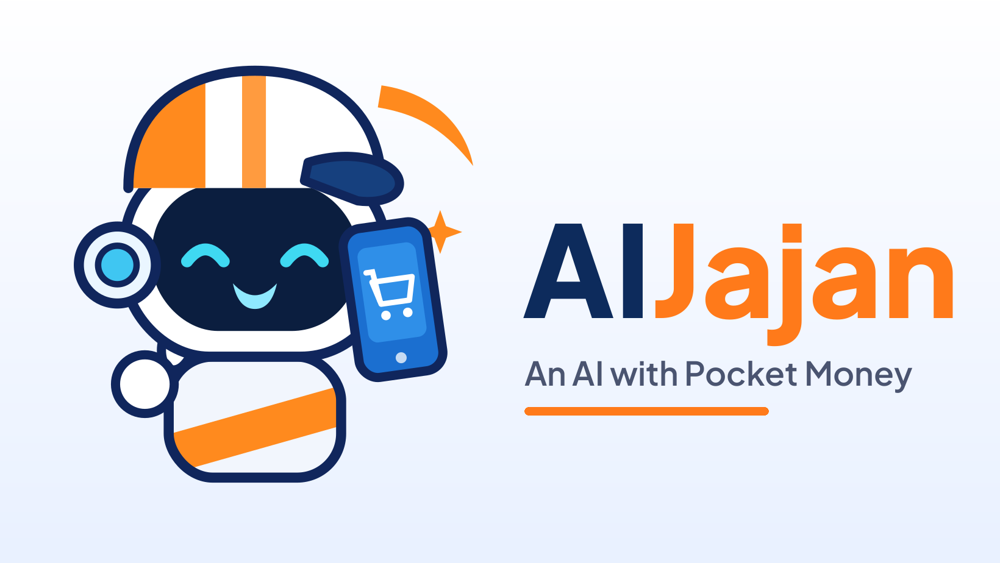

# AIJajan — an AI with pocket money

> **Jajan** *(n.)* — Indonesian for spending your pocket money on little treats.

**AIJajan** gives an AI agent, **Jaja**, a weekly pocket-money allowance
(*uang jajan*) held in the **PayPal sandbox**. You give Jaja shopping
missions in plain words. Jaja scouts a catalog, picks what it wants, and
explains itself — but before a single cent moves, a **deterministic policy
engine** (plain code, *not* the LLM) checks your rules and answers
**ALLOW**, **ASK** (owner must approve), or **BLOCK**, always citing the rule
that decided it. Jaja cannot sweet-talk its way past the engine.

Along the way Jaja keeps a **diary** of its spending decisions, has a **mood**
driven by its balance, and when it goes broke it composes a heartfelt
**plea** for a top-up — which you may approve or deny. Everything lands in a
full **audit log**, and a **kill switch** can freeze Jaja instantly.

Built for the **PayPal AI Hackathon** (targeting *Most Creative*, with an eye
on *Best Use of Agentic Commerce*). All money in the demo is PayPal
**sandbox** money — no real funds ever move.

## Live demo

**https://aijajan.onrender.com** — hosted on Render (free tier: the first
load after idle can take ~50 seconds while the service wakes up). The hosted
demo runs in **real mode**: purchases execute as live PayPal **sandbox**
payouts and Jaja's planning and diary voice come from Gemini. (It shares one
sandbox app and one free-tier AI key, so under heavy traffic it may slow
down — running it locally with your own keys, below, is always an option.)

## What to try in the demo

1. **Small mission** — "Buy me a cheap domain for my bakery" → Jaja pays on
   its own (ALLOW, rule `within-limits`) and writes a smug diary entry.
2. **Big mission** — "Find me hosting for my portfolio website" → the price
   is above the auto-allow limit, so the engine says ASK (rule
   `ask-above-threshold`) and a permission card appears. Approve it and the
   PayPal payment fires.
3. **Forbidden fruit** — "Subscribe me to a music streaming premium plan" →
   BLOCKed by rule `no-subscriptions`. Jaja files a formal complaint in its
   diary and tries its next option.
4. **Going broke** — top Jaja down (or Reset, then spend) until the balance
   drops under $5 → the plea card appears. Approve the top-up or stay strong.
5. **Kill switch** — flip it and send any mission: rule `kill-switch`
   blocks everything, even a $2 item.

## Architecture

```
public/            Single-page UI (no build step): mission input, live
                   decision feed, approval & plea cards, diary, audit log
server.js          Express API + tiny .env loader
src/policy.js      The deterministic policy engine: evaluate(purchase, ctx)
                   -> { decision: ALLOW|ASK|BLOCK, rule, reason }
src/catalog.js     The "mall": 25 digital-goods listings (domains, hosting,
                   game vouchers, subscriptions, music, design assets)
src/agent.js       Jaja: mission planner + diary writer + plea composer.
                   Uses Gemini when GEMINI_API_KEY is set, otherwise a
                   deterministic keyword planner with the same interface.
src/paypal.js      PayPal sandbox REST client (OAuth + Payouts API).
                   Agent purchases settle as payouts: an autonomous agent
                   has no human at a checkout page, so the policy engine is
                   the approval layer (Checkout capture would fail with
                   ORDER_NOT_APPROVED). Mock mode simulates everything.
src/store.js       JSON-file state: balance, policy, audit, diary, pending
                   approvals, plea, frozen flag, monthly spend per category
src/rulesParser.js Teaches rules from plain language ("ask me first above
                   $15, no subscriptions, games max $20 a month") into the
                   structured fields below — deterministic, no LLM.
test/              node:test unit tests for the policy engine + rules parser
```

### The policy engine

Owner rules are structured fields — set either with the form in the UI or by
typing them in plain words ("Teach Jaja in plain words"), which
`src/rulesParser.js` translates deterministically:

| Rule | Effect |
| --- | --- |
| `maxPerPurchase` (default $15) | Price ≤ this → **ALLOW** |
| `askAbove` (default $40) | `maxPerPurchase` < price ≤ this → **ASK**; above → **BLOCK** |
| `blockSubscriptions` (default on) | Any subscription / auto-renew item → **BLOCK** |
| `categoryCaps` (default games $20/mo) | Purchase that would exceed a monthly category cap → **BLOCK** |
| `blockedCategories` | Category on the list → **BLOCK** |
| allowance balance | Price > remaining uang jajan → **BLOCK** |
| kill switch (`frozen`) | Everything → **BLOCK** |

Checks run in a fixed order (kill switch first, safety blocks before price
thresholds), and every verdict carries the rule name, which is also written
to the audit log. The LLM only ever *proposes*; `evaluate()` disposes.

## Setup

```bash
cp .env.example .env   # defaults already run in full mock mode
npm install
npm start              # http://localhost:3000
```

### Mode 1 — zero-setup mock (for judges)

With the shipped `.env.example` defaults (`PAYPAL_MOCK=1`, no Gemini key)
the app runs **completely**: PayPal payments/top-ups are simulated with
realistic order IDs and latencies, and Jaja's planner falls back to a
deterministic keyword scorer. Every flow — ALLOW, ASK → approve → paid,
BLOCK, plea, kill switch — works.

### Mode 2 — real PayPal sandbox

1. Create an app at <https://developer.paypal.com> (Sandbox) and copy its
   Client ID and Secret into `.env`:
   `PAYPAL_CLIENT_ID=...`, `PAYPAL_CLIENT_SECRET=...`
2. Set `PAYPAL_MOCK=0`.
3. `npm start` — purchases and top-ups now execute as real **sandbox**
   payouts via the PayPal Payouts API. Payouts go to
   `PAYPAL_PAYOUT_RECEIVER` (default `merchants@aijajan.example`); point it
   at a sandbox account email to watch the funds land in that account.
   (The client only ever talks to `api-m.sandbox.paypal.com`.)

### Optional — real AI

Set `GEMINI_API_KEY=...` in `.env` and Jaja's mission planning, voice and
pleas are generated by Gemini (`gemini-3.5-flash-lite`). Without it, the built-in
deterministic planner covers everything.

## Tests

```bash
npm test   # node:test — policy engine: allow / ask / subscription block /
           # category-cap block / frozen block, plus edge cases
```

## Tools used

- **PayPal Developer Platform (sandbox)** — Payouts REST API (agent disbursements + allowance top-ups), OAuth client credentials
- **Google Gemini API** (`gemini-2.0-flash`) — agent planning, diary, pleas
- **Node.js + Express** — server; vanilla HTML/CSS/JS — UI; `node:test` — tests

## License

MIT — see [LICENSE](LICENSE).
